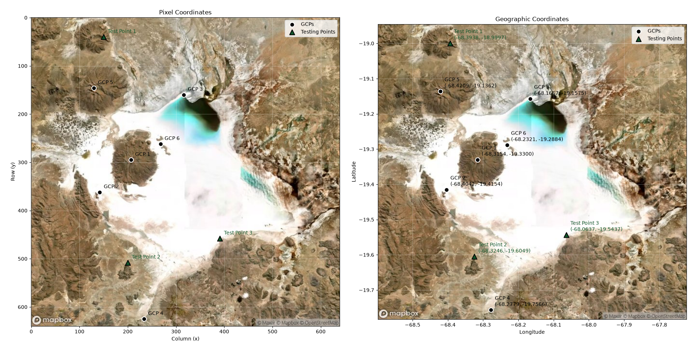

# FINCH Sensor Model

Small Python prototypes for two sensor-model building blocks:

1. **Coordinate transformations** for a camera and for GPS positions.
2. **Image georeferencing** of a PNG from supplied ground-control points (GCPs).

This repository is a collection of runnable, configuration-by-editing scripts. It is not a Python package, command-line tool, or complete end-to-end sensor-model pipeline.

## What it can do

### Convert GPS coordinates to Earth-centred Cartesian coordinates

`Coordinate Transformation/TransVect.py` provides `gps_to_ecef(lat, lon, alt)`.

- Accepts geodetic latitude and longitude in degrees and altitude in metres.
- Uses hard-coded WGS84 semi-major-axis and eccentricity constants.
- Returns Earth-centred, Earth-fixed (ECEF) `X`, `Y`, and `Z` coordinates in metres.
- Demonstrates the calculation for one satellite location and one ground-control-point location.
- Computes an ECEF translation vector by subtracting the GCP position from the satellite position.

### Form a roll–pitch–yaw rotation matrix

`Coordinate Transformation/RotMatrix.py` contains the matrix construction for rotations about the X, Y, and Z axes and combines them as:

```python
R = R_z @ R_y @ R_x
```

This represents a Z–Y–X (yaw, pitch, roll) composition. The script expects `roll_angle`, `pitch_angle`, and `yaw_angle` to be defined before it is run.

### Project a known 3D calibration point into image pixels

`Coordinate Transformation/CoordTrans.py` demonstrates the pinhole-camera projection:

```text
image_homogeneous = K × [R | T] × world_homogeneous
pixel = image_homogeneous[:2] / image_homogeneous[2]
```

The script currently:

- Defines a 3×3 intrinsic camera matrix from focal lengths and principal-point offsets.
- Defines a calibrated 3×3 rotation matrix and 3-element translation vector.
- Builds the 3×4 extrinsic matrix `[R | T]`.
- Uses one point on a planar 25 mm checkerboard and prints its projected 2D image coordinate.

The calibration values and sample checkerboard point are embedded in the script; they are not estimated from images.

### Georeference a PNG using GCPs

`Georeferencing/Georefrencing_PNG_Full.py` uses Rasterio and GeoPandas to associate image pixels with geographic coordinates.

- Accepts Rasterio `GroundControlPoint` objects expressed as pixel row/column plus longitude/latitude.
- Derives an affine transform from those GCPs using `rasterio.transform.from_gcps`.
- Uses EPSG:4326 as the coordinate reference system.
- Writes a GeoTIFF named `salt_flat_with_gcps.tiff` into a chosen output directory.
- Converts non-zero raster regions into vector geometries and writes them as `salt_flat_with_gcps.geojson`.
- Includes four example GCPs and `Georeferencing/testdata.png` as a demonstration input.

## Repository layout

```text
Coordinate Transformation/
  CoordTrans.py                 # fixed-parameter 3D-to-image projection example
  RotMatrix.py                  # roll, pitch, yaw rotation-matrix construction
  TransVect.py                  # WGS84 GPS-to-ECEF conversion and example translation
Georeferencing/
  Georefrencing_PNG_Full.py     # GCP-based PNG to GeoTIFF/GeoJSON workflow
  testdata.png                  # example raster input
notebooks/notebook.ipynb        # empty starter notebook
```

## Setup

The project metadata targets Python 3.10 and Poetry:

```bash
poetry install
```

The coordinate-transformation scripts require NumPy. The georeferencing script also imports Rasterio and GeoPandas, which are used by the source but are not currently declared in `pyproject.toml`. Install them in the same environment before running that workflow:

```bash
poetry run pip install rasterio geopandas
```

## Running the examples

Run the coordinate examples from the repository root:

```bash
poetry run python "Coordinate Transformation/TransVect.py"
poetry run python "Coordinate Transformation/CoordTrans.py"
```

Before running the rotation example, define numeric angles (in degrees) at the top of `RotMatrix.py`, for example:

```python
roll_angle = 0.0
pitch_angle = 0.0
yaw_angle = 0.0
```

Then run:

```bash
poetry run python "Coordinate Transformation/RotMatrix.py"
```

For the supplied georeferencing example, run it from its directory because the script resolves `testdata.png` relative to the current working directory. Create the output directory first:

```bash
cd Georeferencing
mkdir -p output
poetry run python Georefrencing_PNG_Full.py
```

This produces:

```text
Georeferencing/output/salt_flat_with_gcps.tiff
Georeferencing/output/salt_flat_with_gcps.geojson
```

To georeference another image, update the input image path, output directory, and the GCP list in `Georefrencing_PNG_Full.py`. GCP longitude/latitude order and pixel coordinates must match the image being processed.

## Salt Flat Georeferencing Example

This example demonstrates georeferencing using an affine coordinate transformation. Given a set of GCPs, the transformation maps image pixel coordinates $(x_{in}, y_{in})$ to geographic coordinates $(x_{lon}, y_{lat})$:

$$
x_{lon} = Ax_{in} + By_{in} + C \\
y_{lat} = Dx_{in} + Ey_{in} + F
$$

Six GCPs are selected from identifiable features in the image whose geographic coordinates can be estimated using mapping software such as Google Maps. Rasterio uses the corresponding image and geographic coordinates to calculate an affine transformation, yielding the following equations:

$$
x_{lon} = 0.00137x_{in} + 1.76927 \times 10^{-6}y_{in} - 68.59888 \\
y_{lat} = -1.73772 \times 10^{-5}x_{in} - 0.00129y_{in} - 18.94542
$$

The diagram below shows the six GCPs as circles and additional test points as triangles. The test points were not used to estimate the transformation parameters. Instead, they provide a visual check of how well the resulting transformation aligns other locations in the image with their corresponding geographic positions.



## Current boundaries

The repository does **not** currently provide:

- Automatic camera calibration or calibration-target detection.
- Estimation of intrinsic/extrinsic parameters from sensor data.
- A reusable sensor-model API, package entry point, or command-line interface.
- Automated tests for transformation or georeferencing behaviour.
- Validation of GCP quality, georeferencing accuracy, or output products.
- Orthorectification, terrain correction, image mosaicking, or satellite ephemeris/attitude ingestion.
- A complete satellite-image-to-map workflow.

## Development notes

The repository includes Poetry, pre-commit, linting, type-checking, and pytest configuration inherited from a Python project template. The executable functionality currently lives in the standalone scripts above.

## License

This repository is released under the [Unlicense](LICENSE).
